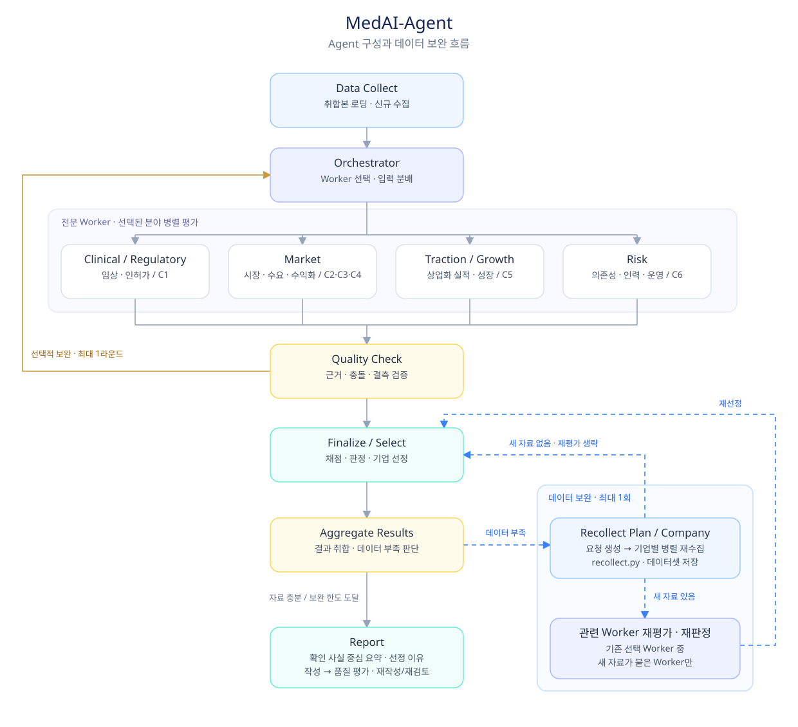
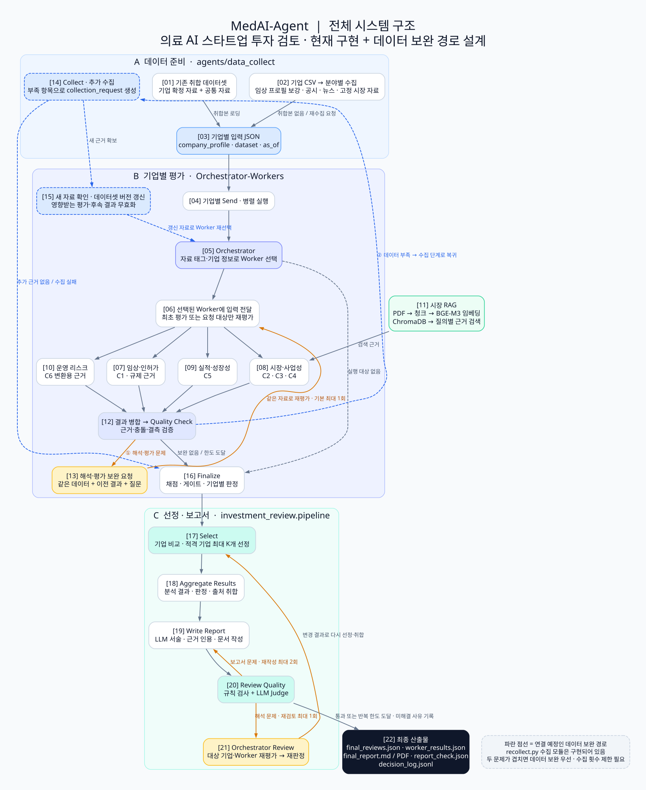

# Subject

본 프로젝트는 의료 AI 스타트업을 임상·인허가, 시장·사업성, 실적·성장성, 운영 리스크 관점에서 비교하는 **Orchestrator-Workers 패턴** 기반 투자 검토 시스템 **MedAI-Agent**임.


## Overview

- Objective : 의료 AI 스타트업을 다각도로 평가해 적격 기업 최대 5개 선정.
- Pattern : **Orchestrator-Workers** — 분야별 분석을 분리하고 실행·보완을 중앙 관리.
- 동적 처리 : 자료에 따라 Worker를 병렬 실행하고, 검증 결과에 따라 선택적으로 재평가.
- 입력 → 출력 : 기업 정보·수집 자료 → 평가 결과·선정 사유·투자 검토 보고서.

## Selected Technologies

| 구분 | 선정 기술 | 선정 이유 |
|---|---|---|
| Agent Pattern | **Orchestrator-Workers** | • 분야별 분석 분리<br>• 필요한 Worker만 실행<br>• 보완·반복 중앙 관리 |
| Framework | **LangGraph** | • 조건부 분기·병렬 실행<br>• 상태·결과 병합<br>• 보완 루프 제어 |
| RAG · Embedding | **[BAAI/bge-m3](https://huggingface.co/BAAI/bge-m3) + Sentence Transformers** | • 의미 기반 근거 검색<br>• 로컬 임베딩 실행 |
| RAG · Vector DB | **ChromaDB** | • 벡터·출처 통합 저장<br>• 유사도 검색<br>• 인덱스 재사용 |

시장 Worker는 `rag/market`의 BGE-M3·ChromaDB 기반 검색 결과를 평가에 활용한다.

## Features

- **자료 수집** : PDF·웹 자료 추출 및 기업별 데이터셋 구성.
- **동적 분석** : 자료에 따라 전문 Worker 선택·병렬 실행.
- **근거 추적** : 출처·근거·판단 연결 및 시장 RAG 검색.
- **선택적 보완** : 검증 이슈에 따른 Worker 재평가, 데이터 부족 시 자동 재수집 및 관련 Worker 재평가.
- **확증 편향 방지** : 분야별 독립 분석, 근거 충돌·결측·불확실성 검증.
- **보고서 품질 평가** : 규칙 검사·LLM Judge를 통한 인용·수치·내용 검증 및 재작성.

## Tech Stack

| 구분 | 기술 및 현재 설정 |
|---|---|
| Language | Python |
| Framework | LangGraph, LangChain |
| LLM/Generator | OpenAI 연동. 임상 기본값 `gpt-4o-mini`, 실적·성장성 기본값 `gpt-6-luna`, 보고서 작성 기본값 `gpt-4.1`, 보고서 Judge 기본값 `gpt-4o`. 시장·Risk는 `MARKET_MODEL`, `RISK_MODEL`로 지정 |
| Retrieval | ChromaDB. Hit Rate@K·MRR은 확인된 측정값 없음; 정답셋과 K를 고정한 평가 필요 |
| Embedding | 오픈소스 [BAAI/bge-m3](https://huggingface.co/BAAI/bge-m3), Sentence Transformers |
| Parsing / Collection | pypdf, Requests, Beautiful Soup, Playwright |
| Validation / Test | Pydantic, pytest |

모델명은 저장소의 설정값이며, 실제 실행 모델은 환경변수로 변경할 수 있다.

## Agents



파란 점선은 구현된 데이터 보완 경로다. `aggregate_results → recollect_plan → recollect_company(기업별 병렬) → 관련 Worker 재평가·재판정 → select`로 이어진다. 재수집은 최대 1회이며, 기존 선택 Worker 중 새 자료가 붙은 Worker만 재평가한다. 새 자료가 없으면 재평가를 생략한다.

[PNG 이미지](docs/diagrams/presentation/medai_agents.png) · [SVG 원본](docs/diagrams/presentation/medai_agents.svg)

| 구성 요소 | 역할 |
|---|---|
| Data Collect 모듈 | 취합본 로딩 또는 신규 수집으로 기업별 프로필·데이터셋 준비. 초기 준비는 별도 CLI로 수행하며 통합 pipeline의 부족 항목 추가 수집도 담당 |
| Orchestrator | 데이터셋 기반 실행 대상 선택, Worker별 입력 분배, 기업별 그래프 조립 |
| Clinical / Regulatory | 임상 근거와 인허가·규제 자료 분석, C1 및 관련 게이트 평가 입력 제공 |
| Market | 시장 성장, 수요·도입, 수익화 관점 분석, C2·C3·C4 평가 |
| Traction / Growth | 상업화 실적과 성장 근거 분석, C5 평가 |
| Risk | 외부 자원 의존, 핵심 역할 연속성, 운영 사건 분석, C6 변환용 근거 제공 |
| Quality Check | 분석 결과 교차 검증, 보완 가능 이슈 분류, 재검토 요청 및 반복 한도 관리 |
| Finalize / Select | 평가 정책에 따른 채점·게이트·판정 및 기업 간 선정 |
| Aggregate Results (취합 노드) | 판정·선정 결과와 Worker 근거 취합, 데이터 부족 판단 및 재수집 경로 분기 |
| Recollect Plan / Company | 기업별 수집 요청 생성·병렬 추가 수집. 갱신된 데이터셋 저장 후 관련 Worker 재평가·재판정·재선정 |
| Report 모듈 | 통합 pipeline 또는 저장된 결과로 근거 중심 요약·선정 사유, 인용·문서 생성과 품질 검사. 기업별 인허가·연구·계약은 각 최대 4개 표시 |

Data Collect는 데이터 준비 모듈이며, Quality Check와 Finalize / Select는 규칙 기반 그래프 처리 노드다. 취합·재수집 연결은 `agents/investment_review/pipeline.py`와 `report/nodes.py`에 구현되어 있다.

## State Schema

| 항목 | 처리 방식 |
|---|---|
| 구조 | `CompanyState`: 기업 평가 · `RunState`: 기업 간 선정 · `PipelineState`: 재수집·보고서 관리 |
| 제어·데이터 분리 | `ControlState`: 계획·보완 요청 · `PayloadState`: 기업 정보·분석 결과 |
| 저장 | 원문은 파일에 저장, State는 `dataset_ref`로 참조 |
| 추적 | 실행·기업·요청 ID와 버전으로 결과 연결, 처리 이력 기록 |
| 병렬 처리 | `Send`로 분배, 결과는 키별 병합·로그는 누적 |
| 복구 | Worker 예외는 실패로 기록, SQLite 체크포인트 설정 시 기업·후속 단계 단위 재개 |
| 반복 한도 | 기본 기업 보완 1회 · 재수집 1회 · 보고서 재작성 2회 · 해석 재검토 1회 |
| 갱신 | 새 자료가 붙은 기존 선택 Worker만 재평가, 후속 취합·보고서 재생성 |

## Architecture



[PNG 이미지](docs/diagrams/presentation/medai_architecture.png) · [SVG 원본](docs/diagrams/presentation/medai_architecture.svg) · [편집용 Graphviz 소스](docs/diagrams/presentation/medai_architecture.dot)

기업별 평가 → 선정 → 취합 → 보고서 작성·품질 검사로 진행한다.

- **평가 보완** : 요청받은 Worker 재평가.
- **자료 부족** : 재수집 후 관련 Worker 재평가.
- **보고서 보완** : 재작성 또는 해석 재검토.

## Directory Structure

```text
.
├── data/                         # 기업 목록 및 수집·가공 자료
├── agents/
│   ├── data_collect/             # 취합본 로딩, 분야별 수집, 데이터셋 갱신
│   ├── orchestrator/             # 동적 라우팅, 그래프, 실행 CLI
│   ├── clinical_regulatory/      # 임상·인허가 분석 및 수집
│   ├── market/                   # 시장·사업성 평가
│   ├── traction_growth/          # 실적·성장성 평가
│   ├── risk/                     # 운영 리스크 평가 및 수집
│   └── investment_review/        # 평가 정책, 검증, 채점, 선정
│       └── report/               # 보고서 생성·검사 및 prompts/
├── rag/market/                   # 시장 자료 임베딩·인덱스·검색
├── examples/                     # 예제 입력과 결과
├── scripts/                      # 실행·데이터 처리 보조 스크립트
├── tests/                        # 테스트
├── docs/                         # 상세 설계·개발 문서·이미지
├── outputs/                      # 실행 결과 저장
├── common_state.md               # 공통 State 및 입출력 계약 설계안
├── requirements.txt              # Python 의존성
├── README.md
└── README_tmp.md
```

진입점은 루트 `app.py` 대신 각 패키지의 `__main__.py`를 사용한다. 프롬프트는 해당 모듈 내부에 배치한다.

## Usage

Python 3.11 이상 권장. 저장소 루트에서 실행한다.

```bash
# 설치
python3 -m venv .venv
source .venv/bin/activate
pip install -r requirements.txt

# 데이터 준비: 별도로 받은 취합본 사용
python -m agents.data_collect.load --input collected_dataset.json --out outputs/bundles

# 평가·선정·보고서 생성
python -m agents.investment_review.pipeline --input outputs/bundles --out outputs/pipeline
```

- **설정** : `.env`에 `OPENAI_API_KEY`, `MARKET_MODEL`, `RISK_MODEL`, 재수집용 `TAVILY_API_KEY` 지정.
- **입력** : `collected_dataset.json`은 별도 준비. 기업별 `as_of`가 평가 기준일로 우선 적용됨.
- **결과** : `outputs/pipeline/`에 평가 JSON·보고서·품질 검사 결과 저장.
- **상세** : [데이터 준비](agents/data_collect/README.md) · [평가·보고서](agents/investment_review/README.md)

## Contributors

SKALA 4기 울산캠퍼스 2반 5조

<table width="730" border="1" cellspacing="0" cellpadding="6">
  <tr>
    <td width="20%" align="center"><a href="https://github.com/minsol1"><br><b>김민솔</b></a></td>
    <td width="20%" align="center"><a href="https://github.com/insidesight0921-stack"><br><b>변현준</b></a></td>
    <td width="20%" align="center"><a href="https://github.com/apej460"><br><b>서준영</b></a></td>
    <td width="20%" align="center"><a href="https://github.com/overdozya"><br><b>안동선</b></a></td>
    <td width="20%" align="center"><a href="https://github.com/yuhalyn"><br><b>유하린</b></a></td>
  </tr>
  <tr>
    <td width="20%" align="center">Worker 결과 취합<br>품질 검사·Fallback 설계<br>보고서 생성·판단 노드 구현</td>
    <td width="20%" align="center">실적·성장성 분석 노드 구현<br>Orchestrator 구현<br>LangSmith 기반 동적 처리 검증</td>
    <td width="20%" align="center">임상·인허가 분석 노드 구현<br>전체 데이터 취합<br>Fallback 시 재수집 구현</td>
    <td width="20%" align="center">시장·사업성 분석 노드 구현<br>RAG 구축</td>
    <td width="20%" align="center">Risk 분석 노드 구현<br>공통 State 구조 관리<br>전체 아키텍처 기획</td>
  </tr>
</table>