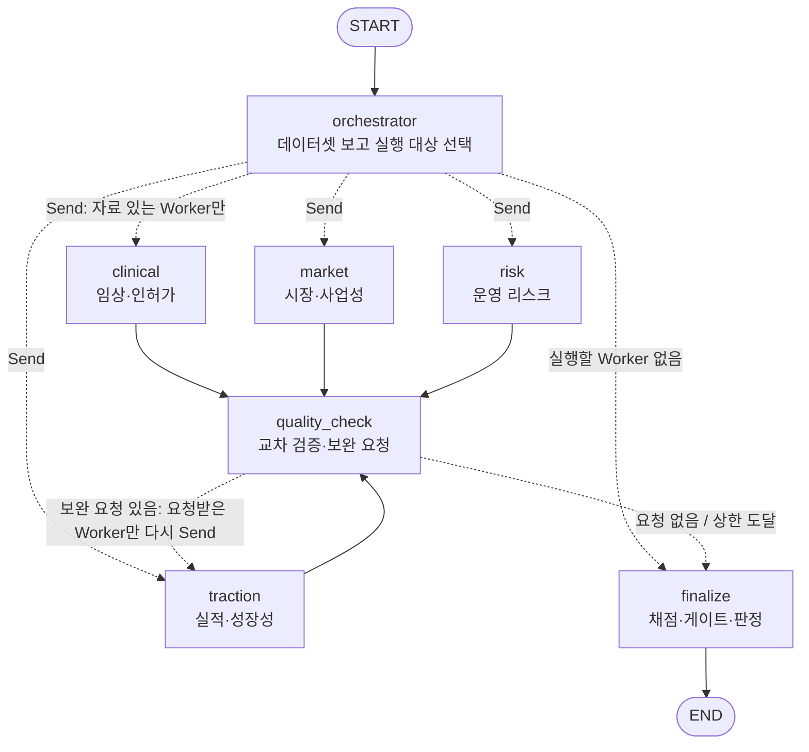

# Orchestrator — 자료 있는 Worker만 골라 실행 (Orchestrator-Workers)

수집된 데이터셋을 보고 **그 기업에 자료가 있는 분석 노드만** 동적으로 골라 병렬 실행합니다.
그다음 결과를 검증해 필요할 때만 보완 루프를 돌리고 판정합니다.

## 1. 구조



전체 실행은 기업마다 위 그래프를 `Send`로 병렬 실행한 뒤 `select`(적격 기업 중 상위 K개)로 모읍니다.

| 노드 | 하는 일 | 하지 않는 일 |
|---|---|---|
| `orchestrator` | 레코드 표시(tags·agent)로 Worker별 자료 수를 세서 실행 대상 선택, Worker별로 자료를 잘라 전달 | 평가 |
| Worker 4개 | 받은 자료로 **한 번** 평가 → WorkerResult | 재시도·재수집·건너뛰기 판단 |
| `quality_check` | `investment_review.validate`로 이슈 검출 → 공통 형식 `review_request` 생성, 재실행 여부·횟수 결정 | 점수 계산 |
| `finalize` | `investment_review.judge`로 판정, 미실행 Worker 사유를 `remaining_unknowns`에 기록 | — |

## 2. 라우팅 규칙 (`routing.py`)

레코드가 어느 Worker 자료인지는 **각 Worker 코드가 실제로 자료를 고르는 방식**에 맞췄습니다.

| Worker | 레코드 표시 | 근거 코드 |
|---|---|---|
| clinical | tags에 `clinical`, `area:*`, `tool:mfds*`, `tool:openfda`, `tool:pubmed` | `clinical_regulatory/collection/collect.py` |
| market | `record.agent == "market"` 또는 tags에 `market` | `market/contract.py` `provided_dataset` |
| traction | tags가 `TRACTION_TAGS` 중 하나 | `traction_growth/evaluator.py` `select_records` |
| risk | tags에 `risk` 또는 `record.agent == "risk"` | `risk/collection/prepare_input.py` |

- 레코드 수가 `min_records`(기본 1) 이상인 Worker만 실행합니다.
- 다른 기업 자료(`company_id`·`company_ids` 불일치)는 세지 않습니다.
- 데이터셋 전체에 표시가 하나도 없으면 판단 근거가 없으므로 4개 모두 실행합니다(보수적 기본값).

## 3. State (기업 그래프 `CompanyState` = `ControlState` + `PayloadState`)

| 구분 | 키 | 설명 | 리듀서 |
|---|---|---|---|
| 필수 | `company_id`, `as_of` | 심사 대상·기준일 | 덮어쓰기 |
| **제어** | `run_id`, `schema_version`, `criteria_version` | 실행 식별·버전 (`run_id` = 외부 로그 연결 키) | 덮어쓰기 |
| **제어** | `plan{selected, skipped, record_counts, unassigned, rule}` | Orchestrator 계획 (건너뛴 사유 포함) | 덮어쓰기 |
| **제어** | `review_requests`, `review_round` | 이번 라운드 보완 요청, 라운드 수 | 덮어쓰기 |
| **제어** | `review_history`, `worker_log` | 라운드별 이슈·요청·상한 도달, Worker 실행 기록 | `operator.add` |
| 페이로드 | `company_profile` | 기업 정보 | 덮어쓰기 |
| 페이로드 | `dataset_ref{version, uri, sha, records, sources}` | 데이터셋 원문 **참조** (원문은 `store.py` 파일 저장소) | 덮어쓰기 |
| 페이로드 | `dataset` | 인라인 원문 (테스트·하위 호환). orchestrator가 참조로 바꾸고 `None`으로 비움 | 덮어쓰기 |
| 페이로드 | `worker_results{worker: WorkerResult}` | 병렬 Worker 결과 | **merge** (dict 합치기) |
| 페이로드 | `investment_review` | 최종 판정 (+ `orchestration` 기록) | 덮어쓰기 |

### 노션 C. State Schema 7개 항목 대응
| 항목 | 설계 반영 | 코드 |
|---|---|---|
| 제어 vs 페이로드 분리 | 라우팅·루프 판단은 제어 값(`plan`·`review_round`·`review_requests`)만 본다. 제어와 페이로드를 TypedDict로 나눔 | `graph.py` `ControlState`·`PayloadState`, `CONTROL_KEYS`·`PAYLOAD_KEYS` |
| 관측성 위치 | 결정과 사유는 State(`plan.skipped`, `review_history`, `worker_log`)에, 실행 추적은 LangSmith | `graph.py` |
| 지속성 비용 | 데이터셋 원문은 파일 저장소에, State에는 참조만. Worker에는 Send 순간에만 자기 몫을 잘라 보냄 | `store.py` `put_dataset`·`load_dataset`·`externalize` |
| 상관 | `run_id`·`thread_id`를 LangSmith metadata로 전달, 요청 ID(`{기업}:{worker}:rr{n}`)로 요청↔응답 연결 | `__main__.py` config, `build_review_request` |
| 재개/복구 | `--checkpoint`로 SQLite 체크포인터 저장, `--resume <thread_id>`로 멈춘 지점부터 재실행(끝난 기업은 건너뜀). 실패는 `failed`+`errors`로 State에 기록 | `store.py` `make_checkpointer`·`invoke_resumable` |
| 동시 처리 | 병렬 Worker의 `worker_results`는 merge 리듀서, 이력은 `operator.add` | `graph.py` |
| 종료 보장 | 보완 라운드 상한 `max_review_rounds`(기본 1), 상한 도달 시 `stopped_by_cap` 기록 | `_quality_node` |

측정(실제 데이터 c001·c021, 2026-10-13): 데이터셋 원문 2개 1.9MB는 저장소에 한 번만 저장됐어요. 체크포인트 8개의 합계는 0.22MB였어요. 원문을 State에 두면 체크포인트마다 원문이 복사돼 약 15MB가 돼요(추정).

Worker에는 State 전체가 아니라 `Send`로 **WorkerInput 9개 키만** 보냅니다.
`{run_id, company_id, as_of, schema_version, criteria_version, company_profile, dataset(그 Worker 몫), previous_result, review_request}`
- 다른 키를 넣지 않습니다. market의 WorkerInput은 `extra="forbid"`라서 모르는 키가 하나라도 있으면 검증에 실패합니다.
- traction은 State 키를 읽는 `traction_worker_node` 대신 WorkerInput을 그대로 받는 `evaluate_worker`를 호출합니다.

## 4. 실행

```bash
python -m agents.orchestrator --graph                                   # 구조(Mermaid)
python -m agents.orchestrator --input bundles.json --dry-run            # 분기 계획만 (비용 없음)
python -m agents.orchestrator --input bundles.json --out outputs/orchestrator
python -m pytest agents/orchestrator -q                                 # 테스트 (가짜 Worker)
python -m agents.orchestrator --input bundles.json --checkpoint outputs/orchestrator/checkpoints.sqlite
python -m agents.orchestrator --input bundles.json --checkpoint outputs/orchestrator/checkpoints.sqlite --resume <thread_id>
```

- 입력 파일 하나에 기업 1곳, 기업 목록, `{company_id: 기업}` 형태 모두 쓸 수 있습니다.
- Worker별 수집 결과를 따로 가지고 있으면 `"datasets": [ds1, ds2]`로 넣으세요. `merge_datasets`가 하나로 합칩니다.
- 옵션:
  - `--workers traction risk`: 실행을 허용할 Worker 제한
  - `--min-records N`: Worker 실행에 필요한 최소 레코드 수
  - `--max-review-rounds N`: 기업당 보완 라운드 상한
  - `--policy zero_fill|partial|strict`: 판정 정책
- 출력:
  - `final_reviews.json`: 판정 결과. 각 기업의 `orchestration`에 계획·보완 이력·Worker 실행 기록이 들어 있습니다.
  - `worker_results.json`

## 5. 설계 결정과 이유

1. **라우팅은 규칙 기반.**
   - "자료가 있는가"는 태그로 확인할 수 있는 사실이라 LLM이 필요 없습니다.
   - 같은 입력이면 같은 분기가 나와 재현·비용 예측이 됩니다.
2. **Worker별로 데이터셋을 잘라서 보냄.**
   - LLM 입력이 줄고, 다른 Worker 자료가 섞이지 않습니다.
   - `dataset.version`은 바꾸지 않습니다. risk와 traction이 재검토할 때 버전 일치를 확인하기 때문입니다.
3. **재실행 판단은 `quality_check` 한 곳에서만.**
   - Worker는 단순 노드로 둡니다(평가 1회, 실패도 결과로 반환).
   - 실패한 Worker, 실행 대상이 아니었던 Worker, 보완으로 못 고치는 이슈에는 요청하지 않습니다.
4. **보완 요청 형식을 하나로 통일.**
   - `common_state.md`의 ReviewRequest에 `request_id`, `attempt`, `reason`, `questions`, `target_finding_ids`, `dataset_version`을 담습니다.
   - 질문 키가 Worker마다 달라 `question`(risk·traction)과 `text`(clinical·market)를 둘 다 넣습니다.
5. **기존 심사 로직 재사용.**
   - `investment_review`의 `validate`, `judge`, `select`, adapters를 그대로 씁니다. 판정 정책은 한 곳(`policy.py`)에만 둡니다.
   - Risk 결과는 기존 어댑터가 읽는 형식(`areas`·`passages`)으로 변환해서 넘깁니다.
6. **Worker 예외 처리.**
   - 예외가 나도 `failed` + `errors`(WORKER_EXCEPTION)로 기록하고 심사를 계속합니다.
7. **clinical coverage `not_applicable` = 검토 완료.**
   - 공통 계약에서 `not_applicable`은 규제 비대상 제품을 뜻합니다.
   - 기존 clinical 어댑터는 이 값을 미검토로 보기 때문에 G01이 `not_checked`가 되고 판단불가로 이어졌습니다.
   - 팀원 어댑터는 수정하지 않고, Orchestrator의 변환 단계에서 처리합니다.

## 6. 검증 (2026-10-13)

- 테스트 14개 통과(가짜 Worker)
  - 분기, 자료 분할, 보완 루프 1회, 상한 정지, 예외→failed, 자료 없음→바로 finalize, 기업 2곳 병렬
  - **노드 간 스키마 일치**: Send로 보낸 입력을 각 Worker의 실제 입력 검증 코드에 넣어 봤습니다.
    market `parse_input`, risk `_validate`, traction `CommonReviewRequest` 모두 통과했습니다(첫 평가 + 보완 요청).
  - clinical `not_applicable` → G01 clear
- 저장된 결과 예시(clinical `c002.json`, market `offline_result.json`)를 변환 단계에 넣어 결과 → 심사 입력 변환도 확인했습니다.
- 기존 `investment_review/tests`도 함께 통과했습니다(112 passed, 1 skipped). 기존 코드는 수정하지 않았습니다.
- basedpyright(standard 모드) 오류 0.
- 실제 데이터 스모크(c001 레모넥스, c002 브라이토닉스이미징)
  - 입력: traction 캐시 수집 결과 + risk 고정 데이터를 합친 데이터셋.
  - 분기: `selected=[traction, risk]`, clinical·market은 "자료 없음"으로 건너뜀. 의도대로 동작했습니다.
  - 보완 루프: c002에서 traction C5 미확인 → `c002:traction:rr1`로 1회 재실행 → 상한 도달 후 finalize.
  - 한계 1: 검증 환경(VM)에서는 OpenAI 연결이 막혀 traction이 `LLM_EXTRACTION_FAILED`, risk가 `RISK_MODEL is required`로 실패했습니다. **실제 LLM 경로는 미검증**입니다.
  - 한계 2: 따라서 판정 결과(판단불가)는 의미가 없습니다. Mac `.venv`에서 `.env`에 `RISK_MODEL`을 넣고 다시 확인해야 합니다.

## 7. 남은 과제 / 팀 합의

- **임상 자료가 없는 기업의 판정**
  - clinical을 건너뛰면 G01이 `not_checked`가 되어 기존 판정 규칙상 판단불가가 됩니다("자료 부족 ≠ 안전").
  - 의도한 동작인지 팀에서 확인이 필요합니다.

- **태그 규칙 확정**
  - 01 공통 수집 노드가 레코드에 Worker 표시(tags 또는 agent)를 반드시 남겨야 라우팅이 됩니다.
  - market은 지금 `agent` 필드를 쓰고, 나머지는 tags를 씁니다.
- **자료 부족형 보완 요청**
  - "근거 없음/점수 미확인" 이슈는 같은 자료로 다시 평가해도 결과가 바뀌기 어렵습니다.
  - 이런 요청은 재수집(01) 쪽으로 보내는 경로가 필요합니다. 지금은 같은 자료로 재평가만 합니다.
- **보고서 품질 평가 루프**
  - 과제의 "보고서 품질 평가 노드"는 `investment_review/report`(작성·검사)와 연결이 필요합니다.
- **Risk Worker 환경**
  - Risk Worker는 Python 3.11 이상이 필요합니다(`typing.NotRequired` 사용).
  - `.env`에 `RISK_MODEL`이 필요합니다.
