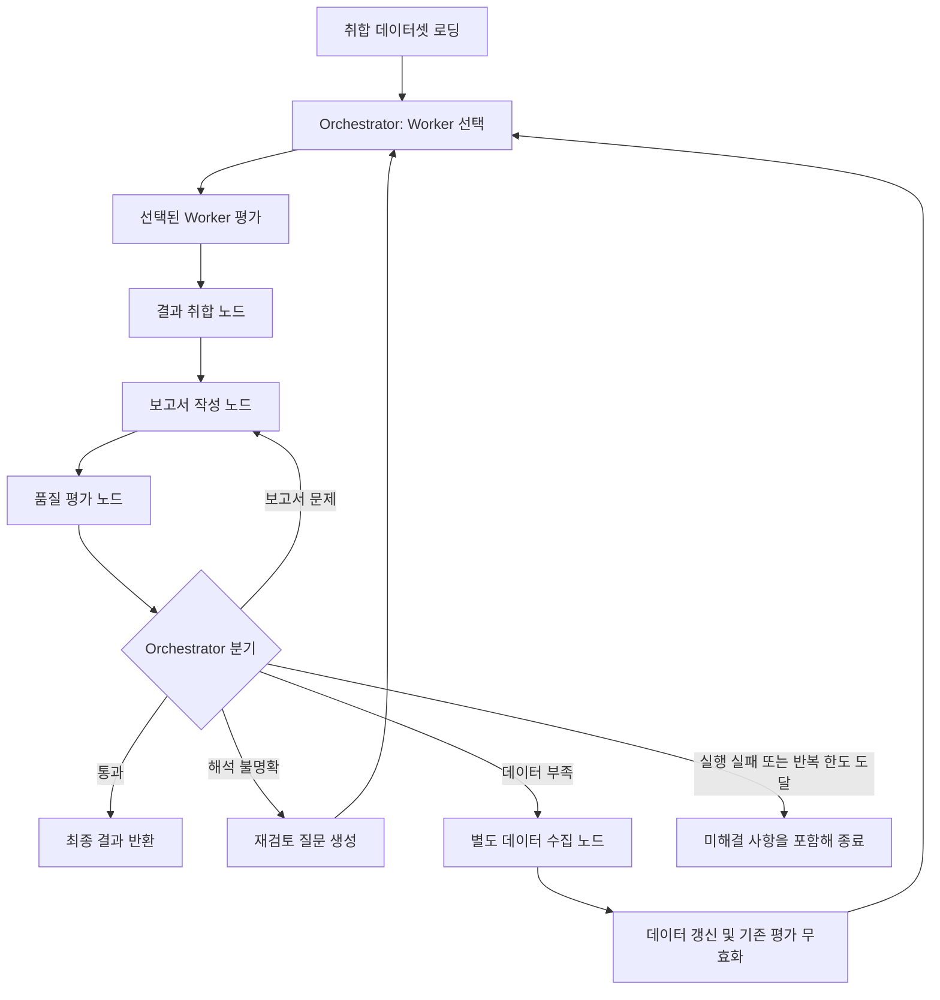

# 공통 State 및 Worker 입출력 계약 초안

팀 논의용 설계안이며 현재 구현이나 확정 계약을 의미하지 않습니다. 각 Worker는 전달받은 데이터로 평가만 수행하는 단일 노드입니다. 평가 기준은 [평가 정책 초안](../evaluation_policy.md), 현행 Risk 구현은 [Risk 문서](risk.md)를 참고합니다.

## 1. 전체 실행 흐름



- 최초 평가는 팀에서 취합한 데이터셋을 사용합니다.
- Worker 내부의 검색·수집·보완 루프는 제거합니다. 병렬 실행과 재실행은 Orchestrator가 관리합니다.
- 해석 재검토는 같은 데이터와 이전 결과, 재검토 질문으로 수행합니다.
- 데이터 부족은 별도 수집 노드에서 보완합니다. 새 자료가 없으면 동일 평가를 반복하지 않고 미해결로 종료합니다.
- 해석 문제와 데이터 부족이 함께 있으면 데이터 보완을 우선합니다.
- 취합·보고서 작성·품질 평가는 각각 별도 노드입니다. 품질 평가는 문제를 반환하고 Orchestrator가 경로를 결정합니다.

## 2. 전체 State 구조

**그래프 실행 1건은 기업 1개를 평가합니다.** 여러 기업을 처리할 때는 기업별로 실행하고 결과를 취합합니다. Worker는 아래 전체 State 중 필요한 입력만 읽습니다.

```text
EvaluationState
├── run_id: str
├── company_id: str
├── as_of: str                         # 평가 기준일, YYYY-MM-DD
├── schema_version: str                # 공통 계약 버전
├── criteria_version: str              # 평가 기준 버전
│
├── company_profile: object
│   ├── legal_name: str
│   ├── aliases: list[str]
│   └── products: list[object]         # product_id, name, intended_use 등
│
├── dataset: object
│   ├── version: str                   # 내용 변경 시 갱신
│   ├── sources: list[Source]
│   └── records: list[DataRecord]      # 원문 및 구조화 자료
│
├── worker_results: dict[WorkerName, WorkerResult]
│   ├── clinical: WorkerResult        # 임상·인허가
│   ├── market: WorkerResult          # 시장·사업성
│   ├── traction: WorkerResult        # 실적·성장성
│   └── risk: WorkerResult            # 리스크
│
├── review_requests: dict[WorkerName, ReviewRequest]
├── collection_request: CollectionRequest | null
│
├── aggregated_result: object | null
│   ├── based_on_results: dict[WorkerName, int]
│   ├── summary: str
│   ├── criteria_results: object      # 평가 정책에 따른 기준별 집계
│   ├── unresolved_items: list[object]
│   └── analysis_status: str          # complete | partial | failed
│
├── report: object | null
│   ├── based_on_results: dict[WorkerName, int]
│   └── content: str                  # Markdown 본문
│
├── quality_review: object | null
│   ├── based_on_results: dict[WorkerName, int]
│   ├── status: str                   # pass | needs_revision | failed
│   └── issues: list[QualityIssue]
│
└── orchestration: object
    ├── status: str                   # pending | running | complete | partial | failed
    ├── selected_workers: list[WorkerName]
    ├── invalidated_workers: list[WorkerName]
    ├── next_action: str              # evaluate | collect | aggregate | write_report
    │                                # | quality_review | finish
    ├── retry_counts: object
    │   ├── worker_reviews: dict[WorkerName, int]
    │   ├── collection: int
    │   └── report_revision: int
    ├── retry_limits: object          # 실행 전에 설정
    │   ├── worker_reviews: int
    │   ├── collection: int
    │   └── report_revision: int
    └── termination_reason: str | null
```

초기값은 `worker_results`와 `review_requests`가 `{}`, 후속 결과와 수집 요청이 `null`, 재시도 횟수가 `0`입니다. 최초 실행은 재시도 횟수에 포함하지 않습니다. Worker 이름은 `clinical / market / traction / risk`를 제안합니다.

## 3. 공통 데이터셋 계약

| 유형 | 필드 | 의미 |
|---|---|---|
| Source | `source_id`, `title`, `url`, `published_at`, `collected_at` | 출처. URL·공개일이 불명확하면 null |
| DataRecord | `record_id`, `source_id`, `content`, `locator`, `tags` | 원문 또는 구조화 자료. locator는 페이지·절 등이며 불명확하면 null |

- 각 레코드의 `source_id`는 같은 데이터셋에 존재해야 합니다.
- 레코드 ID에 대응하는 내용은 고정합니다. 수정된 자료에는 새 ID를 발급합니다.
- `tags`는 자료 배분용 보조 정보입니다.
- 큰 자료는 저장 경로로 관리할 수 있지만 Worker 실행 전에 읽을 수 있는 형태로 로딩합니다. 기존 자료 로딩은 외부 재수집과 구분합니다.
- `as_of`는 평가 기준일, `collected_at`은 수집 시점입니다. 기준일 이후 자료의 허용 여부는 평가 정책으로 통일합니다.

## 4. Worker 입력

```python
worker_input = {
    "run_id": "run-2026-09-30",
    "company_id": "c001",
    "as_of": "2026-09-30",
    "schema_version": "2.0",
    "criteria_version": "proposed-2.0",
    "company_profile": {},
    "dataset": {"version": "dataset-v1", "sources": [], "records": []},
    "previous_result": None,  # 재평가 시 해당 Worker의 이전 결과
    "review_request": None,   # 재검토 요청이 있을 때 전달
}
```

Worker는 데이터와 자기 평가 결과에만 관심을 가지며, 실행 대상 선택이나 반복 횟수를 관리하지 않습니다.

## 5. Worker 공통 반환 결과

첨부한 임상 결과처럼 공통 메타데이터와 분야별 `data`를 분리합니다. `agent`는 기존 출력과의 호환성을 위한 이름이며 자율 실행 Agent를 의미하지 않습니다.

```json
{
  "run_id": "run-2026-09-30",
  "company_id": "c001",
  "as_of": "2026-09-30",
  "schema_version": "2.0",
  "criteria_version": "proposed-2.0",
  "agent": "risk",
  "dataset_version": "dataset-v1",
  "result_version": 1,
  "analysis_status": "partial",
  "data": {"areas": []},
  "sources": [],
  "evidence": [],
  "findings": [],
  "missing_items": [
    {
      "missing_id": "c001:risk:mi01",
      "item": "주요 외부 자원의 대체 가능성",
      "reason": "제공 자료만으로 판단할 수 없음",
      "related_criterion_ids": [],
      "required_for_assessment": true
    }
  ],
  "coverage": [],
  "review_responses": [],
  "errors": []
}
```

| 필드 | 공통 의미 및 항목 구조 |
|---|---|
| data | 분야별 상세 결과. Risk는 areas, 임상은 제품별 평가·규제 기록 등 |
| sources | 실제 참조한 Source 목록. 데이터셋의 출처 ID·내용을 유지 |
| evidence | `evidence_id`, `record_id`, `source_id`, `excerpt`, `locator` |
| findings | `finding_id`, `category`, `claim`, `evidence_ids`, `uncertainty`, `related_criterion_ids` |
| missing_items | `missing_id`, `item`, `reason`, `related_criterion_ids`, `required_for_assessment` |
| coverage | `coverage_id`, `area`, `record_ids`, `status`, `note` |
| review_responses | `request_id`, `question_id`, `answer`, `finding_ids`, `resolved` |
| errors | `code`, `message` |

`coverage.status`는 `reviewed / partial / not_reviewed / not_applicable`입니다. 여기서 reviewed는 제공 자료를 검토했다는 의미이며 외부 검색을 완료했다는 의미가 아닙니다.

- 빈 목록은 `[]`, 모르는 값은 `null`로 반환합니다. 근거 부재를 0점이나 문제없음으로 변환하지 않습니다.
- `complete`는 처리 완료, `partial`은 일부 평가 불가, `failed`는 평가 실패입니다. 긍정·부정 평가와는 별개입니다.
- 평가 비대상 여부는 실행 상태와 구분해 `data` 안에 기록합니다.
- 근거 연결은 `findings.evidence_ids → evidence.source_id → sources.source_id`로 확인합니다.
- 원문 연결은 `evidence.record_id → dataset.records.record_id`로 확인합니다. 출처 존재만으로 판단의 정확성을 보장하지는 않습니다.
- ID는 기업·Worker 접두사를 붙여 충돌을 방지합니다. 이전 결과는 로그에 버전별로 보관하고 현재 State에는 최신 결과를 둡니다.

## 6. 재검토 및 수집 요청

### 해석이 불명확한 경우: ReviewRequest

`review_requests["risk"]`에 아래 요청을 저장합니다.

```json
{
  "request_id": "review-risk-01",
  "attempt": 1,
  "reason": "협력 사실만으로 의존성을 추정했는지 확인",
  "questions": [
    {"question_id": "q01", "question": "대체 가능성을 판단할 근거가 있는가?"}
  ],
  "target_finding_ids": [],
  "dataset_version": "dataset-v1"
}
```

Worker는 같은 데이터로 재평가하고 `review_responses`에 질문별 답변을 기록합니다. 재실행했다고 결론을 반드시 바꿀 필요는 없습니다. 처리된 요청은 Orchestrator가 제거해 중복 실행을 막습니다.

### 데이터가 부족한 경우: CollectionRequest

```json
{
  "request_id": "collect-01",
  "attempt": 1,
  "based_on_dataset_version": "dataset-v1",
  "target_workers": ["risk"],
  "items": [
    {
      "worker": "risk",
      "missing_id": "c001:risk:mi01",
      "question": "대체 공급처나 계약 연속성을 확인할 자료가 있는가?"
    }
  ]
}
```

수집 노드만 데이터셋을 갱신합니다. 새 자료가 없으면 버전을 유지하고 종료 이유를 기록합니다. 초기 구현에서는 데이터 변경 시 전체 Worker 결과를 무효화하고 재평가하는 방식을 제안합니다. 영향받는 Worker만 재평가하는 최적화는 자료 의존관계를 판별할 수 있을 때 도입합니다.

### 품질 평가의 지적: QualityIssue

| 필드 | 내용 |
|---|---|
| issue_id | 지적의 고유 ID |
| kind | interpretation / missing_data / report / execution |
| target_workers | 관련 Worker 목록 |
| description | 문제와 수정이 필요한 이유 |
| finding_ids | 관련 발견 사항 ID 목록 |
| missing_ids | 관련 부족 정보 ID 목록 |
| questions | 해결을 위한 질문 문자열 목록 |

품질 평가는 여러 종류의 문제를 동시에 반환할 수 있습니다. Orchestrator가 우선순위와 남은 횟수를 확인해 요청을 만듭니다. 실행 오류는 데이터 부족으로 분류하지 않고, 종료하거나 별도로 합의한 장애 처리 경로로 보냅니다.

## 7. 갱신 주체와 병렬 실행 규칙

| State 영역 | 갱신 주체 |
|---|---|
| 메타데이터·company_profile | 초기화 처리. 실행 중 고정 |
| dataset | 초기 데이터 로더·수집 노드 |
| worker_results[자기 이름] | 해당 Worker |
| aggregated_result | 결과 취합 노드 |
| report | 보고서 작성 노드 |
| quality_review | 품질 평가 노드 |
| review_requests·collection_request·orchestration | Orchestrator |

Worker는 다음과 같이 자기 결과의 변경분만 반환합니다.

```python
return {"worker_results": {"risk": worker_result}}
```

1. `worker_results`는 Worker 이름별로 병합하는 reducer를 둡니다. 병렬 Worker 결과가 서로 덮어써지면 안 됩니다.
2. 같은 Worker를 동시에 두 번 실행하지 않습니다. 재평가 시 해당 키의 결과 전체를 교체하고 `result_version`을 증가시킵니다.
3. 기업·실행·기준·데이터 버전이 요청과 일치하는 결과만 수용합니다.
4. 필요한 Worker가 모두 반환된 뒤 취합합니다. 실패 결과도 명시적으로 반환해 누락과 구분합니다.
5. Worker 결과가 바뀌면 Orchestrator가 후속 취합·보고서·품질 평가를 null로 초기화하고 재생성합니다.
6. `based_on_results`는 `{"clinical": 1, "market": 1, "traction": 1, "risk": 2}`처럼 사용한 결과 버전을 기록합니다.
7. 전체 실행 이력·모델 사용량·캐시는 로그 및 저장 계층에서 관리합니다.
8. 보완 한도에 도달하면 미해결 사항을 남기고 partial 또는 failed로 종료합니다. 구체적인 횟수는 팀에서 확정합니다.

## 8. 저장 형식과 실행 State의 구분

첨부 예시의 바깥 기업 ID 맵은 저장 형식입니다. 기업 한 개의 실행 State 안에 중복해서 넣지 않습니다.

```python
# 단일 Worker의 여러 기업 결과
{"c001": risk_result_c001, "c002": risk_result_c002}

# 여러 Worker 결과를 함께 저장
{"c001": {"clinical": clinical_result, "risk": risk_result}}
```

메타데이터는 State와 Worker 결과에 함께 유지해 결과만 별도로 전달해도 평가 조건을 추적할 수 있도록 합니다.

## 9. 팀 합의가 필요한 부분

1. Worker 이름과 공통 반환 필드 확정.
2. Source·DataRecord로 각 담당자의 기존 데이터를 표현할 수 있는지 확인.
3. 각 Worker의 data 구조와 취합 노드가 읽을 필드 확정.
4. coverage를 필수로 할지, 첨부 임상 구조보다 간소화해도 되는지 결정.
5. 재검토·추가 수집·보고서 수정의 횟수 상한과 종료 정책 확정.
6. 기존 risk_analysis 등에서 새 계약으로 변환하는 어댑터가 필요한지 결정.

공통 입력·출력 계약을 먼저 확정한 뒤, 각 담당자가 분야별 data 구조를 제출하는 순서를 제안합니다.
